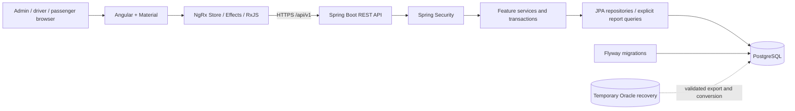
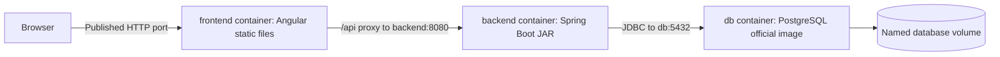
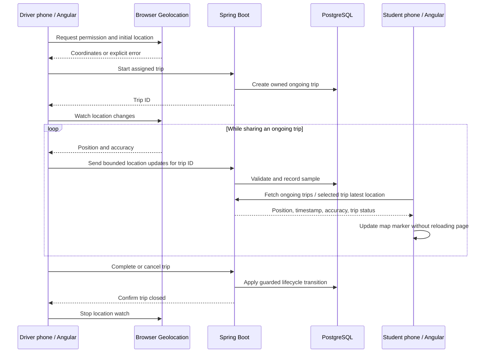

# Bus Management System: architecture and delivery plan

Prepared 6 November 2026. Status: backend/database foundation, backend CI and Angular/Material shell implemented; business workflows and the local container stack is implemented; business workflows remain planned. See database-setup.md and next-steps.md for the current runnable scope. It builds on the legacy implementation assessment and database analysis. User-selected direction: Spring Boot 4, Gradle preference, modern Angular, RxJS, NgRx Store, CRUD APIs, automated testing, Docker images and Docker Compose, and a documented learning portfolio.

## Application identity

Use **Bus Management System** as the public application name and `bus-management-system` as the repository/project slug. Use neutral application identifiers throughout the login screen, navigation, browser title, demo, README, API documentation, application metadata, Docker images and Compose project.

The application is an independent portfolio modernization. Use generic product descriptions and preserve contributor attribution when source is reused. Describe planned technology as planned until implemented.

## Modernization principle: preserve use cases, redesign implementation

The user explicitly authorizes recreating the application with clean, well-defined code and sensible optimizations. The legacy application is evidence of domain behavior, not a code template to reproduce. Preserve the main user journeys and valid business rules while redesigning Java code, Angular components, APIs, database structure and UI where justified.

- Organize by clear responsibilities, with small cohesive services and components, explicit contracts, meaningful names and consistent validation/error handling.
- Remove unnecessary duplication; share code when a real common responsibility exists. Avoid premature generic frameworks and abstractions that obscure business rules.
- Replace legacy defects and unsafe implementation patterns, including global trip state, plaintext password handling, race-prone ID generation and ambiguous timing boundaries. Record intentional behavior changes and test them.
- Improve queries and data flow where needed: use server paging/filtering, avoid N+1 queries and repeated full-table reads, add justified indexes, and return only required DTO fields. Measure performance before claiming improvements or introducing complex optimizations.
- Preserve outcomes rather than exact page layouts, table names, method signatures or inefficient algorithms. Maintain a use-case-to-acceptance-test mapping to make coverage visible.
- Agent may make routine code-quality improvements within the current feature's scope without separate approval. Document material changes to business rules or user-visible behavior; seek clarification only where the intended outcome cannot reasonably be inferred.
- Keep the implementation simple enough for the learner to understand, explain and maintain. Each PR explains the problem solved, the design choice and how it was verified.

This is an incremental rebuild guided by the existing domain. A feature is complete when its agreed use cases work and quality checks pass, not when its source resembles the old application.

## Recommended decisions

| Area | Proposed choice | Reason and tradeoff |
|---|---|---|
| Backend | Java 25, Spring Boot 4.1.2, Gradle 9.8.2 with Kotlin DSL and committed wrapper | Java 25 is the chosen LTS baseline, supported by Boot and Gradle. The Foojay resolver can provision a missing JDK. Application code remains Java; preview features are not enabled. |
| Organization | Modular monolith, organized by business feature | One deployable application with clear boundaries; manageable for one learner. |
| Database | PostgreSQL 18.6 pinned by image digest, Boot-managed Flyway 12.4.0 SQL migrations | Free/open-source engine, repeatable local/CI databases, explicit schema history. Oracle conversion adds an initial task. |
| Legacy recovery | Isolated temporary Oracle instance | Restore/export the final dump and verify legacy rules; not a second permanent production database. |
| Frontend | Angular 22.2.5, Material/CDK 22.2.6, RxJS 7.8.2; NgRx with the first shared business feature | Standalone components, strict typing, typed reactive forms, feature routes, reactive data flow. |
| State | NgRx Store + Effects + Entity for shared feature state; signals for local UI state | Practice explicit reactive state without putting every input field in a global store. |
| Maps | Leaflet (accepted); tile provider pending | Driver/student live maps and recorded-trip replay. |
| UI | Angular Material/CDK | External HTML/SCSS per component; one blue/orange Material theme with shared semantic color variables and local layout styles. Add no paid component or theme dependency. |
| Authentication | Spring Security server session, same-origin cookie, CSRF protection | Fits one browser application; avoids introducing a token refresh subsystem before it is needed. |
| Testing | Java unit tests + PostgreSQL integration tests; Angular Vitest; Playwright browser tests | Verify rules, actual database semantics, and complete workflows. |
| Containers | Frontend and backend application images; pinned official PostgreSQL image; Docker Compose | Reproducible development, CI smoke tests, and a complete demo stack. |
| Delivery | One repository, short-lived branches, pull requests, GitHub Actions | Reviewable learning history and reproducible checks. |

The backend starter pins Java 25, Boot 4.1.2 and Gradle 9.8.2. The frontend pins Angular 22.2.5, CLI/build 22.2.6, Material/CDK 22.2.6, TypeScript 6.0.3 and Transloco 8.4.0, with a committed npm lockfile and Node 24 baseline. Remaining version candidates are not a tested dependency lock. Before implementing each remaining component, verify Angular/Material/NgRx peer dependencies and PostgreSQL driver/Flyway support; then pin exact versions and commit wrappers/lockfiles. Keep Java 25 consistent across development, future GitHub Actions jobs and backend Docker build/runtime stages. PostgreSQL 18.6 is pinned by tag/digest in Compose and Testcontainers; Flyway 12.4.0, JDBC driver 42.7.14 and Testcontainers 2.0.5 are managed by Boot. Database setup and integration checks are documented in [database-setup.md](database-setup.md). Current Spring documentation lists Boot 4.1.2 with Java 17–27 and Gradle 8.14+ or 9.x; Angular's matrix lists Angular 22 with Node 24.15+ as one supported option. Proposed Node baseline: compatible Node 24 patch. Avoid preview releases.

## Languages and localization

Required UI languages: **English (`en`), German (`de`) and Arabic (`ar`)**. English is the initial default; all three are part of the planned application scope. The Angular starter implements localization for the shell, overview, preferences and not-found route; subsequent business screens must extend all three dictionaries.

- Provide a visible language selector and remember the user's selected language locally. Switching language must preserve the current workflow and form input.
- Keep translation resources for each language. Translate navigation, forms, validation, dialogs, Material table/paginator labels, loading/empty/error states, trip/map status text and accessibility labels. Transloco 8.4.0 provides runtime translation with bundled dictionaries; see [ADR 0002](decisions/0002-frontend-localization.md).
- Set document language and layout direction appropriately: English/German use LTR; Arabic uses RTL. Use logical layout properties and review navigation, tables, forms and map controls in both directions. Maps must retain attribution and usable controls.
- Format dates, times and numbers for the selected locale. Display language does not change the service timezone or the meaning of stored timestamps.
- Keep API field names, status codes and error identifiers stable across languages. Translate known application/validation errors in the UI; do not expose raw database exceptions. If backend-generated messages or documents later require localization, define their locale handling explicitly.
- UI translations and domain content are separate. User-entered names/comments are not automatically translated. Preserve legacy English/Arabic content and define additional German route/stop text fields or translation records when implementing routing; never invent German translations as recovered legacy data.
- Every delivered UI feature must include all three language resources. Verify language switching and preference persistence, German text expansion, Arabic RTL, locale formatting and representative phone/desktop layouts. The starter includes unit/browser checks for these behaviors; extend coverage with delivered features.

## Accessibility

Target WCAG 2.2 Level AA throughout implementation, including English, German and Arabic. Use semantic landmarks/headings, labelled controls, visible focus, keyboard navigation, managed route/dialog focus, localized page titles, readable contrast and zoom/reflow support. Material primitives help but do not guarantee conformance. The starter includes axe and keyboard regression checks; extend them with each delivered flow and review incomplete scan results. Real screen-reader, browser zoom and interaction-state checks remain manual acceptance work; see [frontend accessibility](frontend-starter.md#accessibility).

## Architecture



Production-style routing serves the Angular static files from the frontend container and routes `/api` to the backend under the same browser origin. Caddy serves static files and proxies /api to the backend; see container-stack.md. NgRx Store manages shared frontend application state. Docker Compose defines the frontend, backend, and PostgreSQL services. Development can run Angular and Spring Boot on the host with the Angular API proxy and only PostgreSQL containerized. One application instance is sufficient initially; document in-memory session loss on restart. A shared session store is a later scaling decision.

## Docker architecture and deliverables



- **Frontend image:** multi-stage Dockerfile; Node builds the Angular application, then a lightweight static-file server serves the compiled assets; Caddy is selected for static serving and same-origin API routing. Include browser-route fallback and the API proxy. Use a relative `/api` base URL; the browser cannot resolve Compose-only hostnames such as `backend`. Do not embed environment secrets in frontend bundles.
- **Backend image:** multi-stage Dockerfile; a JDK and the Gradle wrapper build the executable JAR, then a Java runtime image runs it as a non-root application user. Keep build tools out of the runtime stage. Supply database credentials and settings at runtime. CI tests remain explicit prerequisites; image creation is not evidence that tests passed.
- **Database image:** use a pinned official PostgreSQL image as the third service/image. We do not need to maintain a custom PostgreSQL Dockerfile unless a concrete extension requires it. Store database contents in a named volume, never in the image. Flyway creates/upgrades the schema; a development-only seeding command supplies synthetic demo data.
- **Compose files:** root `compose.yaml` for the three-service demo; `compose.dev.yaml` as an explicit override for development-only settings, such as loopback database access; `infra/compose.oracle-recovery.yaml` for an isolated, temporary Oracle restoration environment after compatibility checks. The default stack uses PostgreSQL only. Document the exact command combinations, rather than relying on an implicit override.
- **Networking and readiness:** expose the frontend port by default. Backend and database communicate by Compose service names, not fixed IPs or `localhost`. Add database and backend readiness checks; gate backend startup on a healthy database and frontend startup on a healthy backend. Add sensible connection recovery for failures after startup. Restrict Actuator exposure to the health endpoint needed by the stack.
- **Configuration:** add `.env.example`, ignored local configuration, `.dockerignore` files, and static-file server/routing configuration. No passwords, raw dumps, exports or database volume directories in build contexts. Pin base-image versions/digests during implementation and document updates. Include the healthcheck tools needed by the chosen runtime images.
- **Persistence:** document normal stop/restart, backup/restore, and an explicitly destructive demo reset separately. Verify data survives container replacement. Container volume persistence does not replace backups.
- **Learning:** practice image layers, build stages, image versus container, service DNS, ports, environment configuration, volumes, health checks, logs, and Compose troubleshooting through actual feature work.

Proposed acceptance command: `docker compose up --build -d` starts the demo from a clean checkout with documented local configuration. Verification includes `docker compose config`, image builds, healthy services, browser refresh on nested routes, `/api` proxying, login/CRUD when available, and persistence after recreation. Local HTTP is sufficient for a basic localhost demo; phone-based geolocation testing needs an appropriate HTTPS origin. Deployment TLS configuration will be documented separately.

Image publication to a registry is a later delivery step after a registry and release policy are selected. Initial CI builds and tests images without publishing. The current compose.yaml implements frontend/backend/PostgreSQL services with health dependencies and the existing database volume. Caddy serves the Angular build and proxies the backend. compose.dev.yaml retains the optional loopback database port for host-run development. Full-stack startup, persistence and database recovery were verified locally; container CI follows next. See [container setup](container-stack.md).

Backend modules/packages:

- `identity`: accounts, password hashes, roles, authenticated-user lookup.
- `fleet`: buses, drivers, one-to-one current assignment.
- `routing`: stops, ordered route stops, localized route details (legacy English/Arabic; German content added explicitly).
- `scheduling`: timetable versions, stop times, bus assignments and overlap checks.
- `trips`: dated trip executions, lifecycle, location samples and replay.
- `feedback`: passenger reviews and rating calculations.
- `reporting`: read-only projections and filters.
- `shared`: small technical components such as error responses and clocks, not a generic business superclass framework.

Each feature uses API DTOs/controllers, application services, domain rules, and persistence as needed. Controllers handle HTTP; services enforce rules and transaction boundaries; repositories handle storage. Do not expose JPA entities as JSON or copy JSF view/session state into singleton services. Dependencies cross feature boundaries through explicit service interfaces.

## Data and correctness design

Use stable generated IDs, explicit foreign keys, unique constraints, and check constraints. Proposed entities: account/role, driver profile, passenger profile, bus, driver assignment, stop, route, route stop, timetable version, timetable stop, bus assignment, trip, trip stop snapshot, trip location, review. Route/schedule composite legacy identifiers map to new IDs through migration mapping tables.

A timetable is reusable; a trip is an actual execution on a service date. Once used, timetable/stop versions are immutable or copied into trip snapshots. Editing a route must not rewrite historical trips. Deactivate referenced master data; allow hard deletion only for unreferenced records.

Store actual instants as `timestamptz` and Java `Instant`; recurring schedule times as local time plus day offset and service timezone. Proposed service timezone is `Asia/Amman`, to confirm against legacy data. Do not assume the developer's Berlin timezone. Handle midnight explicitly and test it. Use numeric latitude/longitude with range checks; maintain capture and receipt times and a deterministic sample sequence.

Scheduling transactions must prevent races: lock the bus row before checking/writing its assignments. Every assignment create/update/delete and affected timetable edit must follow the same locking protocol; lock multiple buses in sorted order. Validate overlaps with existing assignments, excluding the row being edited. A PostgreSQL exclusion constraint on concrete time ranges is a later option, not a substitute for defining recurrence correctly. Concurrent integration tests must show only one conflicting assignment succeeds.

Trip operations carry an explicit trip ID and check driver ownership and current status in the backend. Use optimistic locking or guarded updates for transitions, plus a uniqueness rule for one active trip per driver/bus. A repeated start request must not create duplicate trips; define idempotency keys or a unique service-date/schedule-assignment key before implementation. No static active-trip or replay state.

Preserve one review per passenger/trip at database level; ratings are 1–5 and averages preserve decimals. Imported plaintext passwords are not reused. Demo users are seeded with modern hashes through development-only setup.

Proposed behavior decisions to resolve through acceptance examples:

1. Preserve the current prohibition on touching schedule endpoints initially, then decide whether turnaround time or half-open intervals better represents operations.
2. Normalize start eligibility to include exactly 30 minutes before departure; punctuality is on time at exactly ±10 minutes. These are deliberate fixes to old boundary gaps.
3. First scope: daily schedules, with inactive state and date validity; weekdays/holidays are a separate extension unless recovered data requires them.
4. Support English, German and Arabic, including Arabic RTL, for delivered feature screens.
5. Reviews initially follow the legacy eligible-completed-trip behavior; no claim of verified ridership without a booking/check-in system.

## API and UI blueprint

Base path `/api/v1`; JSON request/response DTOs, server-side validation, consistent problem-detail errors, paging and whitelisted sorting. Use 201 for creation, 400 for invalid inputs, 401/403 for authentication/authorization, 404 for absent accessible records, 409 for conflicts or invalid transitions. Authorization is enforced on the server regardless of frontend route guards.

| Capability | Example contract |
|---|---|
| Session | `GET /auth/csrf`, `POST /auth/login`, `GET /auth/me`, `POST /auth/logout` |
| Master data | `GET/POST /buses`, `GET/PUT/DELETE /buses/{id}`; corresponding driver, stop, route resources |
| Assignment | `PUT /buses/{id}/driver-assignment`; `POST /schedule-assignments` |
| Schedule | `POST /routes/{id}/schedules`; version-aware update and stop-time validation |
| Execution | `POST /schedule-assignments/{id}/trips`, `POST /trips/{id}/complete`, `POST /trips/{id}/cancel` |
| Tracking | `POST /trips/{id}/locations`, `GET /trips/{id}/locations/latest`, ordered replay endpoint |
| Feedback | `POST /trips/{id}/reviews` and role-appropriate read endpoints |
| Reports | `GET /reports/trips` with date, route, bus, driver, status, rating filters |

Authentication uses an HttpOnly session cookie (Secure in HTTPS deployments), session rotation at login and invalidation at logout. Expose a separate CSRF token using Spring's SPA integration and Angular's XSRF conventions; refresh it after login/logout. NgRx stores the account summary, not passwords or session secrets. Guards improve navigation; backend permissions provide security. Account creation is admin-only initially, with no public signup.

Frontend features: login, role-specific shell/navigation, bus/driver management, route/stop editor, schedule editor, driver trip screen, passenger trip list/map, review form, admin reports. Reusable patterns include loading/empty/error states, confirmation dialogs, paginated tables, accessible forms, and field-validation feedback. Use Material rather than mixing component libraries.

Use NgRx actions/effects/selectors for the first bus CRUD slice and later shared trip data. Use RxJS for HTTP effects, search cancellation, polling, and retry policies. Keep form drafts and dialog state local. Use the explicit location-sharing workflow below. Student-view polling stops on route exit/logout; driver capture is owned by the active-trip service and continues across in-app navigation while the application remains active, stopping on confirmed completion/cancellation, logout or an explicit sharing stop. Show stale-location and permission-denied states. Use a simulated route for demos and CI; choose map/tile hosting separately because a free map library does not imply unrestricted free map hosting. WebSockets/SSE are deferred until requirements justify them.

## Live trip map and mobile workflow (required use case)

This is a first-class feature of the new application: a driver starts a trip on a phone, explicitly permits location sharing, sees their location on a map, and students can select that ongoing trip to see the bus move. The map provider is a rendering choice; phone coordinates come from the browser Geolocation API and are sent through our backend.



### Driver experience and capture

1. Driver signs in on their phone, chooses an assigned schedule and taps Start trip. Show the permission request with a short explanation of sharing. Obtain an initial fix before starting by default; permission denial/timeouts must offer a retry and must not report tracking as active.
2. After successful trip creation, open a responsive map with current marker, accuracy indicator, route/stop information and visible sharing/connection status. Start `watchPosition` through an Angular location service and update the marker in place. Geolocation callbacks are browser-controlled; an RxJS pipeline controls upload frequency rather than assuming the device generates a reading on a fixed timer.
3. Proposed initial upload limit: one latest fresh sample per five seconds, with timestamp, latitude, longitude, accuracy and a client sample identifier/sequence. Tune after real-phone testing. Never resend an old coordinate as a newly captured fix. A retry of the same sample retains its identifier and capture time.
4. Backend authenticates the owning driver, checks that the trip is ongoing, validates payloads, deduplicates samples and records capture/receipt times. Out-of-order or replayed uploads must not move the latest location backwards. Define allowed clock skew and rejection behavior in the API contract.
5. Preserve capture across navigation within the active app using one active-trip service, rather than multiple component-owned watches. On refresh, recover the driver's ongoing trip from the server and offer Resume sharing; do not silently start a second trip. Loss of permission, logout or connectivity produces an explicit sharing state.
6. Completion/cancellation must be acknowledged by the backend before the UI claims the trip has ended. Stop capture after confirmation. If a user explicitly stops sharing, mark the trip's location unavailable/stale rather than pretending the trip ended. Closed trips reject new samples.

### Student experience and delivery

Students can browse ongoing trips with route, destination, planned times and last location update, then select a trip to open its map. Initial loading and empty-location states are explicit. Poll the selected trip's latest location/status with RxJS, initially about every five seconds while the view is active; avoid overlapping requests, back off on failures and refresh on return to the page. Update one marker and offer a recenter control; preserve manual pan/zoom.

Return timestamps and accuracy so the UI can distinguish a fresh location from an old one. Proposed stale threshold: 30 seconds since the last acceptable fix, configurable and subject to field testing. Never present a stationary stale marker as verified live tracking. The trip leaves the ongoing list after completion/cancellation, and an open viewer sees the terminal state. Replay is a separate ordered historical view. Students need not share their own location to view a bus.

Polling is the initial delivery design. SSE/WebSockets may replace it if measured load or latency requirements justify the additional lifecycle complexity. Browser refresh is unnecessary for marker updates. Keep map-library objects outside NgRx; store serializable selected-trip, latest-position and request/sharing status only. Scope tracking reads to authorized users and uploads to the assigned driver; define location retention before public deployment.

### Map provider decision: Leaflet accepted

The user has accepted **Leaflet** as the map library. Use it with an appropriately licensed/configured tile provider, which remains to be selected. Keep map presentation behind a small Angular map component so domain/tracking logic does not depend on the provider. Choose a stable library release when implementing.

Google Maps is a deferred alternative only if requirements later justify revisiting the accepted Leaflet decision. It requires billing configuration and an API key, with usage-based charges; verify applicable allowances at implementation rather than promising it is entirely free. Restrict any browser map key to its intended APIs and origins. Leaflet is open source, but tile hosting is a separate service: standard OpenStreetMap tiles have attribution/usage requirements, limited capacity and no availability guarantee. Configure the tile URL/attribution and choose hosting suitable for the demo or deployment. No directions, road snapping or predictive ETA is implied by displaying locations. Route polylines need actual route geometry; do not label straight lines between stops as road directions.

### Responsive design and phone constraints

Mobile-friendly behavior is required from the first UI slice, not just a release polish task. Driver/student screens use a mobile-first layout: flexible full-width maps, reachable touch controls, readable status, collapsible trip details and responsive navigation. Admin tables use deliberate small-screen column layouts or card views; avoid page-wide overflow. Support Arabic RTL and portrait/landscape changes, with map-size recalculation after layout changes.

Test representative widths of 360, 390, 768 and 1280 CSS pixels, keyboard navigation, readable labels and touch targets. Material components alone do not establish responsive behavior. Use browser automation for layouts and real Android/iOS devices for permission, GPS, power/network and screen-lock behavior.

Location sharing requires explicit permission and a secure browser context. Provide HTTPS for real-phone access to the Compose demo; an HTTP LAN address is not equivalent to localhost. Mobile browsers can suspend pages when backgrounded or the screen is locked. Initial scope is foreground web tracking with clear stale-state handling; do not promise uninterrupted background GPS. A strict background-tracking requirement would require a separate platform assessment, potentially a native/hybrid app; installing a PWA alone is not proof of reliability.

### Tracking acceptance checks

- With driver and student sessions on separate devices, starting a trip makes it visible and sequential test positions move the student marker automatically.
- Denied permission, timeout, poor accuracy, offline connection, reconnect, reload, background/foreground and stale data each show an honest state and recover without creating duplicate trips.
- Two drivers cannot upload to, complete or corrupt one another's trips. Duplicate/late samples are handled deterministically.
- Completing/canceling stops sharing, rejects later uploads and updates the student view.
- Map, trip list, forms and controls work at the target widths and in English, German and Arabic; controls do not cover required attribution.
- Playwright uses mocked geolocation/synthetic routes and controlled map assets so CI is independent of paid map APIs, external tiles and physical movement. Real-phone HTTPS testing remains a distinct acceptance step.

## Repository and Spring Boot starter blueprint

```text
bus-management-system/
  backend/
    Dockerfile, .dockerignore
    gradlew, gradlew.bat, gradle/wrapper/, build.gradle.kts
    src/main/java/.../{identity,fleet,routing,scheduling,trips,feedback,reporting}
    src/main/resources/{application.yml,db/migration/}
    src/test/ and src/integrationTest/
  frontend/                   Angular CLI project, package lock, Dockerfile, .dockerignore
  e2e/                        Playwright workflows and synthetic fixtures
  compose.yaml, compose.dev.yaml, .env.example
  infra/                      Frontend serving/routing, recovery Compose, demo setup
  migration/                  Mapping specs and conversion scripts; no raw dump
  docs/                       Architecture, decisions, learning notes, demo guide
  .github/                    Workflows, issue forms, pull request template
  AGENTS.md, README.md, .editorconfig, .gitignore
```

Generate the backend from official Spring Initializr: Java, Gradle Kotlin DSL, executable JAR, Boot 4 stable. Select Web MVC, Validation, Security, Data JPA, PostgreSQL Driver, Flyway and Actuator; add test libraries managed by compatible dependency versions. Include PostgreSQL-specific Flyway support where required. Tests use Spring Security testing and PostgreSQL Testcontainers. Keep Hibernate schema auto-update off: migrations own schema and Hibernate validates it.

The first reusable feature template is a working `buses` slice: create/update DTOs, controller, service, repository, migration, error mapping, authorization checks, unit/integration tests, and matching Angular list/form/store/effects. It becomes the reference for later features. Avoid an abstract generic CRUD controller that hides feature rules.

## Delivery milestones and pull requests

Each row is a milestone, split into small PRs where necessary. Finish and demonstrate each gate before progressing; estimates come after the database recovery spike.

| Stage | Concrete work | Completion evidence | Learning focus |
|---|---|---|---|
| 0. Repository baseline | Establish Bus Management System identity, create independent successor, preserve contributor/history context and legacy baseline; add docs, issue/PR templates, AGENTS guidance; exclude dumps/secrets from new commits | Verify remotes, clean checkout, baseline reference, agreed scope | Git branches, remotes, PRs |
| 1. Database feasibility | Restore final dump in isolated Oracle; inventory objects; resolve duplicated metadata; export schema/data; compare rules and counts | Import log, object statuses, table counts, encoding checks, mapping and sample PG conversion | SQL, constraints, migration |
| 2. Starter and CI | Generate backend/frontend, application Dockerfiles, three-service Compose, first Flyway migration, test setup, basic CI | Fresh clone builds; Compose services healthy; migrations and tests pass in Actions | Boot configuration, Gradle, Angular CLI, Docker, CI |
| 3. Identity and shell | Login/logout/me/CSRF, roles, Material shell, guards, account state | Correct roles allowed; direct unauthorized API access denied; logout invalidates session | Spring Security, Angular routing, NgRx |
| 4. First vertical slice | Bus CRUD from PostgreSQL through API to Material table/form | Create/edit/list/delete and validation tested end to end | JPA, DTOs, reactive forms, effects |
| 5. Fleet and routing | Drivers, assignments, stops, ordered routes with localized content | Assignment/deletion/ordering constraints tested; RTL screen reviewed | Relationships and reusable UI patterns |
| 6. Scheduling | Versioned stop times, assignment conflict logic, date/time boundaries | Touching/contained/overnight/concurrent conflict tests pass | Transactions, locking, time modeling |
| 7. Trips and maps | Phone location sharing, responsive driver/student maps, explicit lifecycle and ownership, simulated GPS and deterministic replay | Two-device live tracking works; concurrent drivers isolated; permission/offline/stale states and mobile/RTL layouts verified | Geolocation, maps, RxJS, state machines, responsive design |
| 8. Reviews and reports | Unique reviews, decimal ratings, paginated filtered reports, immutable history | Duplicate submissions rejected; aggregate/report fixtures match expected values | Queries, projections, correctness |
| 9. Migration rehearsal | Full selected data transform/load, reconciliation and rerun/rollback exercise | Counts, relationships, Arabic text, timestamps and samples reconciled | ETL, validation, recovery |
| 10. Portfolio release | Accessibility/responsive pass, demo data, startup guide, architecture/decision docs, walkthrough and release tag | Fresh-machine demo and full CI; generic branding and historical attribution checked; clear before/after evidence | Technical communication, release practice |

Migration mapping evolves alongside stages 4–8. Public synthetic demo work can continue if Oracle recovery is blocked; no claim of complete data migration until stage 9 passes.

Repository publication detail: the legacy history already includes database dumps and hardcoded connection settings. A `.gitignore` does not remove these from inherited history. Preserve the original repository and a local/private historical copy; before making the successor public, choose whether to sanitize only the successor history or publish a clean successor with explicit original commit attribution. Do not rewrite the original repository. This qualifies the earlier recommendation to carry all history into a new public repository.

## GitHub Actions and validation

The backend workflow `.github/workflows/backend-ci.yml` is merged and has passed on GitHub. It validates the wrapper, runs Java 25 tests/build with PostgreSQL Testcontainers and retains test reports. The frontend workflow `.github/workflows/frontend-ci.yml` adds format/lint/type/unit/build and Chromium browser/accessibility checks; hosted PR/main checks passed after merge. See [frontend CI](frontend-ci.md). A separate container-ci.yml builds application images and runs isolated Compose smoke checks; hosted verification is pending publication. See [Container CI](container-ci.md). Trigger on pull requests and pushes to `main`. Use least-privilege `contents: read`, timeouts, cancellation of superseded runs, and pinned reviewed action revisions. Do not execute untrusted PR code with privileged secrets. CI uses synthetic data only.

- Backend: setup Java; validate/use Gradle wrapper; cache through setup-gradle; run formatting, unit and integration tasks, migration checks, and package JAR. Proposed command contract: `./gradlew check integrationTest bootJar`; define the custom task before enabling that workflow command.
- Database: PostgreSQL Testcontainers for backend tests. Apply Flyway to an empty database and test upgrade from the preceding schema snapshot when migrations evolve. Do not use H2 as evidence of PostgreSQL compatibility.
- Frontend: pinned Node, `npm ci`, `npm run lint`, `npm run test:ci`, `npm run build`. Define these scripts using the generated Angular tooling; current Angular CLI uses Vitest.
- Images/Compose: build both application images, validate Compose configuration, start the stack using the pinned PostgreSQL image, wait for health, and run proxy/API smoke checks. Capture container logs on failure and clean up the ephemeral CI stack.
- E2E: run against the built frontend/backend container stack with PostgreSQL; wait on health checks; seed synthetic roles; run Playwright login/CRUD and later lifecycle/authorization scenarios. Upload logs, screenshots and traces on failure with finite retention.
- Keep stable required check names. An aggregate required check fails when any mandatory job fails or unexpectedly skips. Add protection to `main` after check names exist.
- Measure meaningful coverage around business rules; do not use a coverage percentage as a substitute for concurrency, permissions and migration tests.
- Dependency updates through a bot can be a later small PR. Deployment/publishing is separate from the initial testing workflow and awaits a chosen hosting environment.

## Agent-assisted learning workflow

One issue → short plan and model/effort recommendation → focused branch → implementation → local checks → diff review → user handoff with commit message → user commit/push → hosted CI and PR review → user-controlled merge → learning note. The agent leaves changes unstaged, uncommitted and unpushed unless the user explicitly authorizes a Git action. Each handoff identifies the next bounded step and recommends its model/effort before work begins. One agent is sufficient initially. No autonomous multi-agent setup is required.

Each task states the behavior, acceptance examples, scope, evidence, and the concept you will practice. Before a substantial implementation, explain the relevant design briefly. You implement a bounded part when you want hands-on practice; the agent assists and handles explicitly delegated work. Review outcomes by running checks and reading the diff, not by the confidence of the agent's description.

`AGENTS.md` should record verified setup/test commands, feature boundaries, migration rules, no shared mutable user state, no raw dump/credentials in commits, and the teaching preference. Add reusable skills only after a workflow repeats. Keep a short learning note: problem, chosen approach, alternative, checks, and what you can explain in an interview.

## First three PRs

1. `docs: establish modernization baseline`: README, architecture/decisions, migration inventory, issue/PR templates and agent instructions. Confirm independent repository destination before first push.
2. `chore: add application skeleton and CI`: generated Boot/Gradle and Angular projects, frontend/backend Dockerfiles, PostgreSQL service, Compose configuration, migrations and baseline tests. Keep it independently runnable.
3. `feat: add role-based login and application shell`: session security, guards and shared account state with permission tests. Then the first bus CRUD PR.

Database recovery is a local spike alongside PR 1; private exports remain outside tracked source. No paid infrastructure is necessary for local work. Public hosting cost and GitHub plan quotas must be checked when deployment is selected.

## Sources checked

- [Spring Boot requirements](https://docs.spring.io/spring-boot/system-requirements.html) and [Spring Initializr](https://start.spring.io/).
- [Angular compatibility](https://angular.dev/reference/versions), [Angular testing](https://angular.dev/guide/testing), [NgRx](https://ngrx.io/guide/store/install), [Material table](https://material.angular.dev/components/table/overview). NgRx/Material pages are JS-rendered; package compatibility is still a scaffold-time verification gate.
- [Spring Security SPA/CSRF guidance](https://docs.spring.io/spring-security/reference/servlet/exploits/csrf.html).
- [GitHub Gradle CI](https://docs.github.com/en/actions/tutorials/build-and-test-code/java-with-gradle) and [Playwright CI](https://playwright.dev/docs/ci-intro).
- [Browser location watch](https://developer.mozilla.org/en-US/docs/Web/API/Geolocation/watchPosition), [Leaflet](https://leafletjs.com/), [OSM tile policy](https://operations.osmfoundation.org/policies/tiles/), and [Google Maps billing requirements](https://developers.google.com/maps/documentation/javascript/usage-and-billing).
- [Docker multi-stage builds](https://docs.docker.com/build/building/multi-stage/), [Compose readiness](https://docs.docker.com/compose/how-tos/startup-order/), and [Compose networking](https://docs.docker.com/compose/how-tos/networking/).
- Database sources and evidence are detailed in `database-migration-plan.md`.
