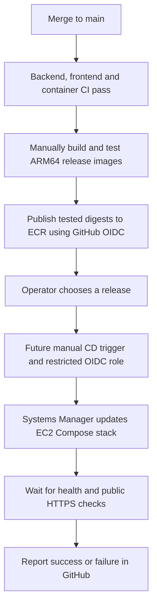

# AWS demo deployment

First disposable demo verified on 12 November 2026: native ARM64 images, public HTTPS, Keycloak signup/login/logout, roles/CSRF and buses CRUD. The developer verified desktop Chrome, mobile Safari and manual bus creation. [Published release](https://github.com/mohsammarraie/bus-management-system/actions/runs/43124299907), source `c59bd3a`. Operator-performed cleanup was verified: instance terminated, root disk deleted, no snapshot for that disk and no remaining demo A record. The three ECR repositories and their images were also deleted; restore the repositories before the next publication.

This is an operator-run guide: run one stage, inspect its output, then continue. An assistant should explain commands and review results; cloud execution and termination require explicit delegation. No deployment command below is run automatically by CI.

## Target and prerequisites

One On-Demand `t4g.small` in Frankfurt, Ubuntu 24.04 ARM64, encrypted 30 GB gp3 root disk, automatic public IPv4 and Standard CPU credits. Public TCP 80/443 serves Caddy; PostgreSQL, Spring Boot and Keycloak administration stay private. Administration uses Systems Manager, without an SSH key or open port 22. No Elastic IP, snapshot, load balancer or NAT gateway is provisioned here. See [capacity/cost assumptions](deployment-learning-plan.md).

Use a named administrator with MFA and temporary CLI login, not root or permanent access keys. The EC2 role can pull images and connect to Systems Manager; it cannot publish images or administer the AWS account. IMDSv2 is required, with hop limit 1 because only host tools need AWS credentials; the application containers do not.

## 1. Confirm the account and select a release — workstation

Run from the repository root, using Bash and AWS CLI v2:

```bash
export AWS_PROFILE=bms-admin
export AWS_DEFAULT_REGION=eu-central-1
aws login --profile "$AWS_PROFILE"
aws sts get-caller-identity
aws freetier get-account-plan-state --region us-east-1
```

Confirm account `749789489994`, the named user and the account plan/credits. Do not upgrade the plan as part of this exercise. Billing is delayed; check Billing and Cost Management again afterward.

First restore/verify the three ECR repositories if they were deleted during cleanup; the publication role cannot create them. Then publish a green `main` commit using [ECR publication](ecr-publication.md), then download its `arm64-release-...` artifact. Keep `release.json`: its `commit` and three `images` references identify the tested release. Use that exact source commit on EC2. Older PR checks do not qualify; rerun cancelled/failed Backend, Frontend or Container CI for the selected commit before publication. A new guide/configuration commit needs a matching publication before its next deployment.

## 2. Runtime role — workstation, one-time setup

The role/profile `bus-management-ec2-demo` was created for the first demo. Inspect it before reuse:

```bash
aws iam get-instance-profile --instance-profile-name bus-management-ec2-demo
aws iam list-attached-role-policies --role-name bus-management-ec2-demo
aws iam get-role-policy --role-name bus-management-ec2-demo --policy-name PullApplicationImages
```

The expected managed policy is `AmazonSSMManagedInstanceCore`; the inline policy allows only ECR authentication and downloads from the three application repositories. The checked-in policy targets this account/region; review ARNs before using another account.

**Only when absent**, create the role/profile:

```bash
aws iam create-role --role-name bus-management-ec2-demo \
  --assume-role-policy-document file://infra/aws/ec2/ec2-trust.json
aws iam attach-role-policy --role-name bus-management-ec2-demo \
  --policy-arn arn:aws:iam::aws:policy/AmazonSSMManagedInstanceCore
aws iam put-role-policy --role-name bus-management-ec2-demo \
  --policy-name PullApplicationImages \
  --policy-document file://infra/aws/ec2/ecr-pull-policy.json
aws iam create-instance-profile --instance-profile-name bus-management-ec2-demo
aws iam add-role-to-instance-profile --instance-profile-name bus-management-ec2-demo \
  --role-name bus-management-ec2-demo
```

The trust policy lets EC2 assume the role; the permissions policies define what it can do. The instance profile attaches that role to the VM. Allow a short propagation delay before launching with a newly created profile.

## 3. Network and Ubuntu image — workstation

Discover the current IDs; do not copy an old instance's address or subnet blindly:

```bash
VPC_ID=$(aws ec2 describe-vpcs --filters Name=is-default,Values=true \
  --query 'Vpcs[0].VpcId' --output text)
aws ec2 describe-subnets --filters "Name=vpc-id,Values=$VPC_ID" \
  Name=default-for-az,Values=true \
  --query 'Subnets[].{Subnet:SubnetId,Zone:AvailabilityZone,PublicIPv4:MapPublicIpOnLaunch}' --output table
aws ec2 describe-route-tables --filters "Name=vpc-id,Values=$VPC_ID" \
  --query 'RouteTables[].{Associations:Associations,Routes:Routes}' --output json
aws ssm get-parameter \
  --name /aws/service/canonical/ubuntu/server/24.04/stable/current/arm64/hvm/ebs-gp3/ami-id \
  --query Parameter.Value --output text
aws ec2 describe-security-groups --filters "Name=vpc-id,Values=$VPC_ID" \
  Name=group-name,Values=bus-management-demo-web
```

Expect an available default VPC, a default public subnet using a route table with an active `0.0.0.0/0` route to an Internet Gateway (`igw-...`), and a Canonical Ubuntu ARM64 AMI. If the default network is absent, stop and plan networking explicitly; this guide does not create a VPC/NAT gateway.

Reuse the existing demo security group after inspecting its rules. **Only when absent**, create it and apply the web rules:

```bash
SECURITY_GROUP_ID=$(aws ec2 create-security-group \
  --group-name bus-management-demo-web --description 'Bus Management public web only' \
  --vpc-id "$VPC_ID" --query GroupId --output text)
aws ec2 authorize-security-group-ingress --group-id "$SECURITY_GROUP_ID" \
  --ip-permissions file://infra/aws/ec2/web-ingress.json
```

Public 80/443 is intentional: HTTP supports redirect/certificate validation and HTTPS serves the application. No database, SSH or administration ingress is allowed. The default outbound rule permits package downloads, SSM, ECR and certificate issuance.

## 4. Review, dry-run and launch — workstation

```bash
mkdir -p infra/aws/generated
cp infra/aws/ec2/run-instances.example.json infra/aws/generated/ec2-launch.json
nano infra/aws/generated/ec2-launch.json
```

Replace the four `REPLACE_...` values with the discovered AMI, selected public subnet, security group and a unique launch token, for example `bms-demo-20261112-01`. Reuse a token only when retrying the same launch request; use a new token for a deliberately new instance. Review `MinCount`/`MaxCount` = 1, Standard CPU credits, encrypted disk and `DeleteOnTermination: true` before continuing. Detailed monitoring is disabled to retain basic five-minute metrics.

```bash
aws ec2 run-instances --cli-input-json file://infra/aws/generated/ec2-launch.json --dry-run
```

Expected: `DryRunOperation: Request would have succeeded, but DryRun flag is set.` This nonzero CLI exit is the expected permission check, not proof of available capacity. The next command actually allocates the VM, disk and public address:

```bash
aws ec2 run-instances --cli-input-json file://infra/aws/generated/ec2-launch.json \
  --query 'Instances[].{Id:InstanceId,State:State.Name}' --output table
```

Copy the returned ID into the variable below; record its disk ID for cleanup:

```bash
INSTANCE_ID=REPLACE_WITH_RETURNED_INSTANCE_ID
aws ec2 wait instance-running --instance-ids "$INSTANCE_ID"
aws ec2 describe-instances --instance-ids "$INSTANCE_ID" \
  --query 'Reservations[].Instances[].{IP:PublicIpAddress,Disks:BlockDeviceMappings}' --output json
aws ssm describe-instance-information --filters "Key=InstanceIds,Values=$INSTANCE_ID" \
  --query 'InstanceInformationList[].{Id:InstanceId,Status:PingStatus}' --output table
```

Wait for SSM `Online`; a new instance may need a few minutes. If it stays absent, check its profile, outbound internet path and SSM Agent before opening SSH as a workaround.

## 5. Install the runtime — EC2 browser terminal

AWS Console → Frankfurt → EC2 → Instances → select this instance → Connect → Session Manager → Connect. These commands run **on EC2**, not on the workstation:

```bash
sudo -i
cloud-init status --wait
apt-get -o APT::Update::Error-Mode=any update
apt-get -o DPkg::Lock::Timeout=180 install -y git ca-certificates
RELEASE_COMMIT=REPLACE_WITH_COMMIT_FROM_RELEASE_JSON
git clone --no-checkout https://github.com/mohsammarraie/bus-management-system.git /opt/bus-management-system
cd /opt/bus-management-system
git checkout --detach "$RELEASE_COMMIT"
bash infra/aws/ec2/bootstrap.sh
export PATH="$PATH:/snap/bin"
```

Read [bootstrap.sh](../infra/aws/ec2/bootstrap.sh) before execution; its commands can also be run individually. It checks root/Ubuntu 24.04/ARM64, waits for cloud-init, adds Docker's signed package repository, installs Docker/Compose and AWS CLI, and prints versions/host resources. It creates no AWS infrastructure, database users or application secrets. Package versions follow the vendor's current stable repositories; review updates before rerunning later.

The final `aws sts get-caller-identity` should identify the `bus-management-ec2-demo` assumed role, not your workstation administrator. Host tools retrieve temporary role credentials; no AWS login or access-key file is needed on EC2.

## 6. DNS — IONOS and workstation

For domain `timbalonia.de`, set **A / hostname `bms` / value = this instance's public IPv4**. Preserve root, www and mail records. An IONOS Default Site conflict listing only the `bms` A/AAAA/service TXT records is expected when replacing its placeholder; confirm only after checking that subdomain is unused. Remove a conflicting `bms` CNAME or stale AAAA; publish IPv6 only when this deployment supports it.

Check authoritative and recursive DNS on the workstation:

```bash
dig +short NS timbalonia.de
dig +short A bms.timbalonia.de
dig +short AAAA bms.timbalonia.de
```

A should resolve to EC2; no AAAA is expected for this IPv4-only demo. If browsers report `ERR_SSL_PROTOCOL_ERROR`, compare DNS results with the EC2 IP before changing TLS. Old IONOS A/AAAA records remained cached during the first test. Wait for cache expiry or temporarily select an already-updated resolver in the browser. A validated direct check is `curl --resolve bms.timbalonia.de:443:EC2_IPV4 https://bms.timbalonia.de/api/health`; never bypass certificate validation. An automatic IPv4 changes on stop/start, requiring another DNS update.

## Images and configuration

Continue in the **EC2 root terminal**, at `/opt/bus-management-system`. Copy all three full digest references from the same `release.json`:

```bash
FRONTEND_IMAGE='REPLACE_WITH_FRONTEND_REPOSITORY@sha256:DIGEST'
BACKEND_IMAGE='REPLACE_WITH_BACKEND_REPOSITORY@sha256:DIGEST'
KEYCLOAK_IMAGE='REPLACE_WITH_KEYCLOAK_REPOSITORY@sha256:DIGEST'
ECR_REGISTRY=749789489994.dkr.ecr.eu-central-1.amazonaws.com
python3 infra/aws/prepare.py --hostname bms.timbalonia.de \
  --frontend-image "$FRONTEND_IMAGE" \
  --backend-image "$BACKEND_IMAGE" \
  --keycloak-image "$KEYCLOAK_IMAGE"
dc() { docker compose --env-file infra/aws/generated/.env -f compose.aws.yaml "$@"; }
dc config --quiet
set -o pipefail
aws ecr get-login-password --region eu-central-1 | \
  docker login --username AWS --password-stdin "$ECR_REGISTRY"
dc pull
docker logout "$ECR_REGISTRY"
```

`prepare.py` generates five random secrets in ignored `infra/aws/generated/.env` with mode 0600 and a secret-free realm template. It refuses to overwrite existing configuration. Do not print `.env`, paste credentials into commands/issues, or publish unredacted `docker compose config` output. For durable deployments, retain protected off-host credentials/backups; the initial disposable demo deliberately retains none.

Compose is standalone, not a local override. The one-shot initializer creates separate application/Keycloak databases and limited owner roles. The realm requires HTTPS, has no seeded demo users and allows only the hostname's callback/logout URLs. Startup import skips an existing realm: hostname/secret changes need coordinated database/realm administration, not just an edited environment file.

## 7. Start and verify — EC2, then browser

```bash
dc up --pull never --no-build -d --wait --wait-timeout 900
dc ps
curl --fail --show-error https://bms.timbalonia.de/api/health
```

Expect all four runtime services healthy, the initializer exited with code 0, and health `UP`. No images are built on EC2. The first `t4g.small` Standard boot took roughly four minutes for Keycloak initialization/import and exceeded the old health deadline. AWS Compose now gives Keycloak 600 seconds of startup grace; a passing health check still makes it ready immediately. If startup fails, inspect `dc ps -a` and the affected service's logs before retrying; do not reset data or regenerate secrets.

Caddy obtains a separate certificate for `bms.timbalonia.de` and persists it in its named volume. Only 80/443 are published. `/identity/admin/`, the master realm and direct `/actuator/health` should return 404; unauthenticated `/api/v1/buses` should return 401.

Open the website on desktop and mobile, register a temporary account and test login/logout. For ADMIN assignment, privately read `KEYCLOAK_ADMIN_PASSWORD` from the protected environment file; authenticate the admin CLI at its password prompt, then assign the application role:

```bash
dc exec keycloak /opt/keycloak/bin/kcadm.sh config credentials \
  --config /tmp/operator.config --server http://localhost:8080/identity \
  --realm master --user deployment-admin
dc exec keycloak /opt/keycloak/bin/kcadm.sh add-roles \
  --config /tmp/operator.config -r bus-management \
  --uusername YOUR_REGISTERED_USERNAME --cclientid bus-management --rolename ADMIN
dc exec keycloak rm -f /tmp/operator.config
```

Log out/in before testing bus create/read/update/delete. Public signup grants PASSENGER; app ADMIN is distinct from AWS administration and Keycloak realm administration. For sustained operation, establish/verify a permanent named Keycloak administrator and remove the temporary bootstrap administrator. Before sustained public use, complete [private vulnerability reporting](next-steps.md#to-do-before-public-deployment-private-vulnerability-reporting), language/RTL/accessibility checks and backup/restore rehearsal.

Optional synthetic buses can be inserted into an existing database without rebuilding/restarting:

```bash
dc exec -T db psql -X --set=ON_ERROR_STOP=1 -U bus_management -d bus_management \
  < infra/demo/buses.sql
```

This inserts missing `DEMO-BUS-001` through `030` registrations and preserves existing rows/edits. The local `seed-demo-data.sh` uses local Compose; use the AWS command above on EC2.

## 8. Monitor — browser or EC2 terminal

EC2 → instance → Monitoring provides CPU/network/status and CPU-credit metrics, normally at five-minute intervals. In the EC2 terminal:

```bash
free -h
df -h /
top
docker stats --no-stream
```

Use `q` to exit top; `docker stats` without `--no-stream` is live and Ctrl+C exits its display. The first post-CRUD reading was about 1.4 GiB host RAM used with 393 MiB available, roughly 4.9 GB disk used, and four healthy containers with zero restarts. This was a short demo, not a load/capacity guarantee. Container limits total 1,600 MiB, swap is disabled and logs rotate at 10 MB × 3 files per container.

Billing and Cost Management → Home/Free Tier shows credit status; Bills shows per-service usage. An unchanged balance immediately after testing is not proof of zero consumption. RAM/filesystem charts need additional collection such as the CloudWatch agent; custom metrics/logs may cost extra. Monitoring automation remains a later exercise.

## 9. Finish a disposable test — workstation or AWS Console

The operator owns cleanup. Remove the IONOS `bms` A record pointing at this instance before releasing its address; preserve unrelated DNS records. Confirm the intended instance and recorded root volume ID before terminating:

```bash
aws ec2 describe-instances --instance-ids "$INSTANCE_ID" \
  --query 'Reservations[].Instances[].{Id:InstanceId,Name:Tags,Disks:BlockDeviceMappings}'
aws ec2 terminate-instances --instance-ids "$INSTANCE_ID"
aws ec2 wait instance-terminated --instance-ids "$INSTANCE_ID"
aws ec2 describe-volumes --volume-ids YOUR_RECORDED_ROOT_VOLUME_ID
```

Alternatively: EC2 → Instances → select the demo → Instance state → Terminate (delete) instance. Termination is irreversible. This launch sets root `DeleteOnTermination: true`: the final volume check should eventually return `InvalidVolume.NotFound`; also verify EC2 → Volumes. No snapshots are created by this guide. If you manually created one, review/delete only that demo snapshot separately. Do not delete unrelated volumes/snapshots.

Stopping preserves the disk and its storage charges; it is not cleanup. Termination releases the automatic public IPv4 and deletes this configured root disk. Keep IAM/profile/security-group setup and empty ECR repositories for reuse. Empty private ECR repositories have no image-storage charge; stored images/artifacts and applicable transfer or optional services can incur charges. Delete unwanted images inside each repository instead of deleting the repositories. Preserve deployed/rollback digests for retained deployments, and review billing after it catches up. See [ECR pricing](https://aws.amazon.com/ecr/pricing/). A fresh deployment requires a new VM, installation/configuration and empty databases unless restored from backups.

## Updates and durable recovery

For a future retained deployment, keep protected off-host credentials and back up both databases before updates. In the EC2 terminal, stop writers while capturing the pair:

```bash
umask 077
mkdir -p infra/aws/generated/backups
dc stop frontend backend keycloak
dc exec -T db pg_dump -U deployment_db_admin -d bus_management -Fc > infra/aws/generated/backups/application.dump
dc exec -T db pg_dump -U deployment_db_admin -d keycloak -Fc > infra/aws/generated/backups/identity.dump
dc up --pull never --no-build -d --wait --wait-timeout 900
```

Check dump exit codes and copy protected backups off the VM. Rehearse restoring into a separate empty deployment: run the initializer, then `pg_restore --exit-on-error --clean --if-exists -U deployment_db_admin -d DATABASE` through `dc exec -T db` before starting writers. Update only the three digest references deliberately, authenticate/pull again, then restart with Compose. Image rollback does not undo Flyway migrations. Backend sessions are in memory, so recreation signs users out.

## Planned CI/CD pipeline

Current: independent CI, manual ARM64 ECR publication and operator-run deployment. Later, add a manually triggered EC2 CD workflow with a separate restricted OIDC deployment role, wait for SSM/health results and retain the previous release for rollback:



`smoke-aws.py` stays a manual **local** disposable check after deployment-configuration changes, not routine CI or a second stack on EC2. Lightweight checks against the actual cloud stack verified real OIDC, signup/logout, ADMIN bus CRUD/conflicts, role/CSRF boundaries and session rotation during the first demo. This branch's longer health grace and generic launch example have not been re-launched on AWS.

References: [Docker Ubuntu installation](https://docs.docker.com/engine/install/ubuntu/), [AWS CLI installation](https://docs.aws.amazon.com/cli/latest/userguide/getting-started-install.html), [EC2 dry-run/launch](https://docs.aws.amazon.com/cli/latest/reference/ec2/run-instances.html), [Session Manager](https://docs.aws.amazon.com/AWSEC2/latest/UserGuide/connect-with-systems-manager-session-manager.html), [IONOS A records](https://www.ionos.de/hilfe/domains/ip-adresse-konfigurieren/domain-mit-statischer-ip-adresse-verbinden/), [Caddy HTTPS](https://caddyserver.com/docs/automatic-https), [Keycloak proxy](https://www.keycloak.org/server/reverseproxy), [realm import](https://www.keycloak.org/server/importExport), [bootstrap administrator](https://www.keycloak.org/server/bootstrap-admin-recovery), [EC2 termination](https://docs.aws.amazon.com/AWSEC2/latest/UserGuide/terminating-instances.html).
