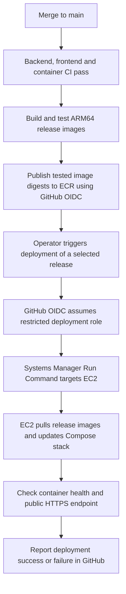

# AWS demo deployment

Status: local preparation only. Selected hostname: `bms.timbalonia.de`, with DNS managed at IONOS. AWS resources, registry images, DNS changes and GitHub deployment permissions remain pending. See [capacity and costs](deployment-learning-plan.md).

## Target

- One On-Demand `t4g.small` in Frankfurt (`eu-central-1`), Ubuntu 24.04 ARM64, encrypted 30 GB gp3 root volume and Docker Engine/Compose 2.24.4+.
- All runtime images are `linux/arm64`; application images are selected by registry digest. PostgreSQL uses the same pinned image as local Compose/Testcontainers.
- `bms.timbalonia.de` points to the instance. Only TCP 80/443 are public. Do not publish PostgreSQL, backend ports, Keycloak administration or management ports. Caddy serves Angular, `/api` and the application's identity paths over one HTTPS origin.
- Prefer Systems Manager access: verify SSM Agent, an instance role with `AmazonSSMManagedInstanceCore`, operator permissions and outbound HTTPS connectivity. An ECR pull policy on the instance role should be restricted to the three application repositories, except `ecr:GetAuthorizationToken`, which requires `Resource: *`.
- Confirm the account promotion, choose CPU-credit mode explicitly and configure cost alerts. Standard mode avoids surplus CPU charges but may throttle. Do not add a load balancer, NAT gateway or managed database to this small demo without revisiting costs.

Install Docker/Compose through the official Ubuntu instructions, enable Docker at boot and verify `docker compose version`. Commands below assume the operator can run Docker, Python 3 and AWS CLI v2. Docker access is effectively host-administrator access.

## Planned CI/CD pipeline

Use continuous delivery with automated checks/image publication and a manual deployment trigger. Current work implements CI and local deployment preparation; registry publication, AWS IAM/OIDC integration and the deployment workflow remain planned. Establish the first working deployment before automating it.



Require all relevant CI checks to pass for the same `main` commit. Record that commit, matching deployment configuration and the three tested image digests as the release; retain the preceding release for rollback. Restrict publication/deployment roles to the repository, approved branch/environment and required AWS resources. Use temporary OIDC credentials; runtime secrets stay on the server. Deployment waits for the remote command and health checks before reporting success. Migration recovery remains a separate decision from image rollback.

Full `smoke-aws.py` verification is a manual local check before deployment or after infrastructure changes; it is excluded from routine CI. EC2 runs the application and lightweight deployment health checks, without a second disposable test stack. `prepare.py` is initial setup, not a step that regenerates credentials on every deployment.

## Images and configuration

Publish tested frontend, backend and themed Keycloak images to ECR before launch, using ARM64 builds outside EC2. Retain the release commit and all three image digests for rollback. PostgreSQL is pulled from its pinned upstream reference. Image publication and GitHub automation are the next step; the existing CI checks do not publish images.

Check out the matching release commit on the VM for Compose, gateway and bootstrap files. From the repository root, with the three published `repository@sha256:...` references in the named shell variables:

```bash
python3 infra/aws/prepare.py --hostname bms.timbalonia.de \
  --frontend-image "$FRONTEND_IMAGE" \
  --backend-image "$BACKEND_IMAGE" \
  --keycloak-image "$KEYCLOAK_IMAGE"

dc() { docker compose --env-file infra/aws/generated/.env -f compose.aws.yaml "$@"; }
dc config --quiet
```

The helper defaults to `bms.timbalonia.de`; `--hostname` can override it. It writes `APP_HOST=bms.timbalonia.de` into ignored `infra/aws/generated/.env` with five random secrets and mode 0600, plus a secret-free first-boot realm template. Compose derives the public app, issuer and Keycloak URLs from that value. The helper refuses to overwrite either file. Keep a protected off-host copy of the environment file; do not paste it or unredacted `docker compose config` output into logs/issues. Use a separate checkout/configuration for each deployment. The AWS Compose file is standalone, not a local-stack override.

The one-shot `database-init` uses `deployment_db_admin` to create separate application/identity databases and non-superuser owners. Each application can connect only to its own database. Spring receives the limited `bus_management` credential, not the PostgreSQL bootstrap administrator's password. Database operations below use the administrator only for backup/restore.

The realm retains passenger signup, en/de/ar, the login theme and PKCE. It requires HTTPS, removes seeded demo accounts and allows only the public callback/logout URLs. Startup import skips an existing realm: changing the hostname, client secret or template does not update an existing database. Apply those changes explicitly through the admin CLI; changing environment passwords alone does not rotate existing database/admin credentials.

## Start and verify

Authenticate Docker to the ECR registry using the instance role:

```bash
aws ecr get-login-password --region eu-central-1 | \
  docker login --username AWS --password-stdin "$ECR_REGISTRY"
dc pull
dc up --no-build -d --wait --wait-timeout 300
dc ps
```

Before startup, set an A record in IONOS for domain `timbalonia.de`: Hostname `bms`, Zeigt auf = the EC2 public IPv4 address. Use the AWS address, not the existing site's server address; preserve root, www and mail records. Review any existing bms A/CNAME/AAAA records for conflicts; publish an AAAA record only if IPv6 is configured for this deployment. DNS setup remains pending until EC2 has its address. See [IONOS A-record instructions](https://www.ionos.de/hilfe/domains/ip-adresse-konfigurieren/domain-mit-statischer-ip-adresse-verbinden/).

Allow inbound 80/443 and outbound certificate issuance traffic. Caddy obtains/renews a separate public certificate for `bms.timbalonia.de`; the existing site's certificate is not reused. Its `/tmp/data` named volume persists certificates and keys with ownership for UID 10001. Container listeners use unprivileged ports 8080/8443, mapped to public 80/443. The internal 8081 health listener is not published. Only application-realm and resource paths reach Keycloak; master-realm/admin paths and direct Actuator paths return 404. Client-supplied `Forwarded` and forwarded-prefix/port headers are removed before proxying.

Runtime memory limits total 1,600 MiB, with container swap disabled; the one-shot database initializer has a separate 64 MiB limit. These are the local capacity probe's starting limits, not an AWS guarantee. All long-running services restart unless stopped. Logs rotate at 10 MB × 3 files per container. No access log is enabled that would record OIDC callback query strings.

Verify `https://bms.timbalonia.de/api/health`, real-phone signup/login/logout, ADMIN CRUD, passenger restrictions, secure session cookies and CSRF. Check en/de/ar, RTL and appearance across the app/Keycloak. Inspect `free -h`, `df -h`, `docker stats --no-stream`, EC2 CPU-credit metrics and billing; record peak startup/use memory. Backend sessions are in memory: recreation signs users out. Metrics/management endpoints remain private; CloudWatch setup is a later slice.

## Private administration

Connect through Systems Manager, then authenticate the admin CLI. The command prompts for the generated `KEYCLOAK_ADMIN_PASSWORD`; it is not a command-line argument:

```bash
dc exec keycloak /opt/keycloak/bin/kcadm.sh config credentials \
  --config /tmp/operator.config --server http://localhost:8080/identity \
  --realm master --user deployment-admin
```

Register your application account normally, then assign its application role:

```bash
dc exec keycloak /opt/keycloak/bin/kcadm.sh add-roles \
  --config /tmp/operator.config -r bus-management \
  --uusername YOUR_REGISTERED_USERNAME --cclientid bus-management --rolename ADMIN
dc exec keycloak rm -f /tmp/operator.config
```

Log out/in to refresh application roles. Use DRIVER instead for controlled driver accounts; public signup grants PASSENGER only. No SMTP/email verification is configured. The bootstrap master-realm administrator is temporary: establish a permanent named administrator, verify its access and remove the bootstrap account before sustained operation, following the Keycloak bootstrap guide. An application ADMIN is not a Keycloak administrator. Keep administration private; do not expose the console to work around CLI setup.

## Updates, backup and teardown

Before an update, record current digests and take both database backups. Stop writers while capturing the application/identity pair:

```bash
umask 077
mkdir -p infra/aws/generated/backups
dc stop frontend backend keycloak
dc exec -T db pg_dump -U deployment_db_admin -d bus_management -Fc > infra/aws/generated/backups/application.dump
dc exec -T db pg_dump -U deployment_db_admin -d keycloak -Fc > infra/aws/generated/backups/identity.dump
dc up --no-build -d --wait --wait-timeout 300
```

Check both dump commands succeeded before updating, and copy backups and protected credentials off the VM. Restore into a separate empty project/VM: start `database-init` to create both databases/roles, then feed each dump to `pg_restore --exit-on-error --clean --if-exists -U deployment_db_admin -d DATABASE` using `dc exec -T db` before starting application services. Rehearse restoration before relying on the backups; named volumes on a root disk do not survive deleting that disk.

For an application update, edit only the three image references in the protected environment file, `dc pull`, then `dc up --no-build -d --wait --wait-timeout 300`. Restore prior digests to roll back images. Flyway changes require their own compatibility/recovery decision; reverting images does not undo a migration. Hostname/secret changes need coordinated realm/database updates as described above.

`dc down` retains data and certificate volumes, but EC2 compute remains billable. Stop the instance between demos. EBS and a retained Elastic IP still incur costs; a released/changed public IP requires DNS updates. For permanent teardown, export required data, remove the intended instance, unwanted disks/snapshots, reserved IP and registry images, and review billing. Never run `down --volumes` against a deployment whose data you want to retain.

## Local verification and follow-up

Before deployment or after changing deployment configuration, build the local images and run `python3 scripts/smoke-aws.py` manually. It uses a unique project, synthetic users, random loopback ports and a trusted local test CA to check the ARM64/digest/no-build model, fresh realm, HTTPS/session cookies, private routes, database role isolation, OIDC/roles/CRUD, application/identity dump restoration and database/identity/certificate persistence, then removes only its resources. It is not run by Container CI. Runtime checks use the host's native architecture; they do not prove Graviton capacity, public DNS/ACME issuance or AWS connectivity. The normal local stack and `.env` are not used.

Before public launch, complete [private vulnerability reporting](next-steps.md#to-do-before-public-deployment-private-vulnerability-reporting). Next, publish ARM64 images and perform a guided AWS launch, then implement the [planned CI/CD pipeline](#planned-cicd-pipeline).

References: [Docker installation](https://docs.docker.com/engine/install/ubuntu/), [Caddy HTTPS](https://caddyserver.com/docs/automatic-https), [Keycloak proxy configuration](https://www.keycloak.org/server/reverseproxy), [realm import behavior](https://www.keycloak.org/server/importExport), [bootstrap administrator](https://www.keycloak.org/server/bootstrap-admin-recovery), [Session Manager prerequisites](https://docs.aws.amazon.com/systems-manager/latest/userguide/session-manager-prerequisites.html), [ECR pull permissions](https://docs.aws.amazon.com/AmazonECR/latest/userguide/security_iam_id-based-policy-examples.html), [GitHub AWS OIDC](https://docs.github.com/en/actions/how-tos/secure-your-work/security-harden-deployments/oidc-in-aws).
