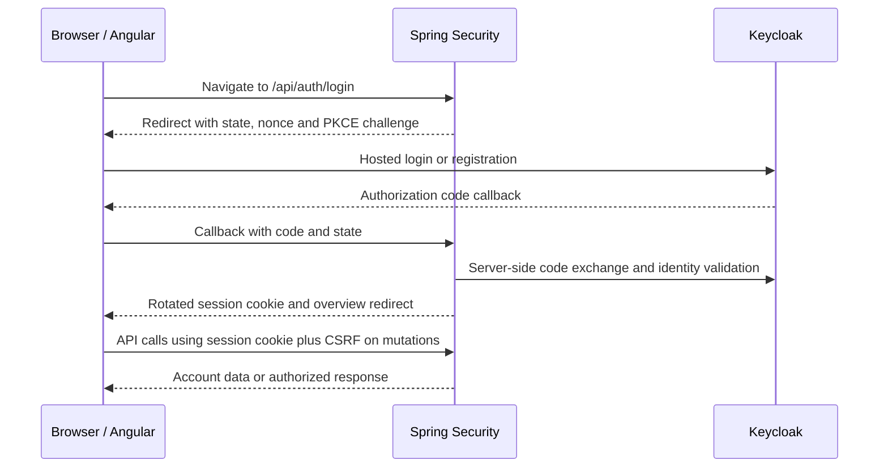

# ADR 0003: Keycloak identity with backend-managed OpenID Connect login

Status: accepted for the MVP, 7 November 2026. This supersedes the application-owned password/account-creation direction in the original roadmap.

## Context

The application needs passenger signup, driver/admin privileges and backend-enforced permissions. The developer has previously implemented an Angular-managed Keycloak client and wants to learn the backend-managed alternative. MVP email services must have no cost: SMTP, email verification and email recovery are omitted. AWS remains a later deployment/monitoring learning target.

## Decision and responsibilities

Use Keycloak 26.8.2 and Spring Security's standard OAuth2/OIDC client support. Keycloak owns credentials, registration and identity roles. Spring completes Authorization Code + PKCE login, validates the OIDC response and creates an application session. Angular will use the session through same-origin API calls, not keycloak-js, browser bearer tokens or token refresh logic. This branch implements the backend/identity foundation; Angular account state and navigation follow separately.

Caddy proxies /api and /identity. The browser sees one origin. The client secret, access/refresh tokens and token exchange remain server-side. The HttpOnly JSESSIONID identifies the backend session; it is not a Keycloak JWT. CSRF uses a separate readable XSRF-TOKEN cookie and X-XSRF-TOKEN request header. The backend token endpoint uses confidential-client authentication; CLIENT_SECRET_BASIC here authenticates the server client, not application users with HTTP Basic Auth.

Keycloak is an identity provider; Spring Security is the application's security integration/enforcement layer. They do not duplicate password authentication. Only known app_roles from the validated ID token become application roles; users cannot select driver/admin access at signup. Application ADMIN does not grant Keycloak administration privileges. Future domain services must additionally enforce assignments and ownership, not merely trust a DRIVER role.

## Comparison with Angular-managed tokens

| Concern | Angular OIDC client | Selected backend-managed client |
|---|---|---|
| OAuth client | Public browser client, usually keycloak-js | Confidential Spring client |
| API credential | Bearer access token | Opaque application session cookie |
| Token lifecycle | Browser library holds/refreshes tokens | Server owns tokens and session |
| Browser script access | Access/refresh tokens are available in memory | Access/refresh tokens not returned to Angular |
| Backend state | Resource-server JWT checks can be stateless | Session storage required |
| Main extra controls | PKCE, token lifetime/storage, API validation | CSRF, cookie/session lifecycle, private token storage |

Both are valid architectures. Our single same-origin browser app already has a backend, so this choice keeps token lifecycle out of Angular and teaches a different pattern. It does not eliminate XSS: malicious scripts may still make requests through the victim's browser. HttpOnly, CSRF, safe rendering, secure deployment and backend authorization remain necessary. JWT bearer validation checks signatures/issuer/audience/time claims, not equality with another JWT fetched from Keycloak. Standard logout may send an ID-token hint in a browser redirect to Keycloak; this is distinct from exposing API access/refresh tokens to Angular storage.

## Consequences and limits

Keycloak adds a service and a separate keycloak database/user on the existing PostgreSQL server. A one-shot idempotent bootstrap supports both new and existing application volumes. Flyway owns only application migrations; Keycloak manages its own schema. No application password table or password hashing implementation is added. Domain profiles can later reference the stable issuer/subject identity, not an unverified email address.

The local realm is a reproducible synthetic fixture with username/password signup, only PASSENGER as the default application role, and no email verification or reset-by-email. Email fields remain unverified and are not used as proof of ownership. Privileged accounts and password recovery require controlled administration. Role changes are reflected on new login; existing Spring sessions are not automatically revoked by Keycloak admin operations in this MVP. Back-channel logout/session revocation, shared session storage and production lifecycle hardening are future work. Sessions expire after 30 minutes idle and are lost on application restart. This is a single-instance local demo, not a completed public-production identity service.

Realm import skips an existing realm. Configuration/credential changes require an explicit migration/admin update, not deletion of application data. Committed demo accounts/secrets are local-only; remove/replace fixtures and configure HTTPS, Secure cookies, trusted proxy boundaries and secret delivery before internet deployment. SMTP, verified email and automated email recovery remain optional post-MVP, with no paid provider selected.

## Verification

Backend tests exercise account responses, anonymous API denial, role boundaries, CSRF cookie/header behavior, PKCE and forged callback rejection. The isolated Compose smoke follows real Keycloak browser-compatible HTTP forms (no direct password grant), verifies role claims/session rotation/logout/signup, then validates identity persistence and database recovery. A real Chromium login is also checked during implementation. Assignment/ownership tests join each business feature; test-only role probes are not packaged in the application.

References: [Spring OAuth2 login](https://docs.spring.io/spring-security/reference/servlet/oauth2/login/advanced.html), [Spring SPA CSRF](https://docs.spring.io/spring-security/reference/servlet/exploits/csrf.html), [Keycloak realm import](https://www.keycloak.org/server/importExport), [Keycloak OIDC](https://www.keycloak.org/securing-apps/oidc-layers).
